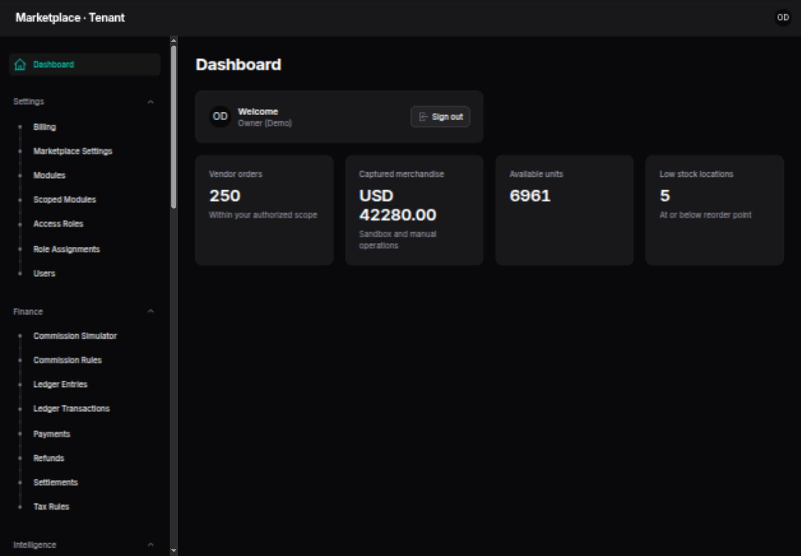
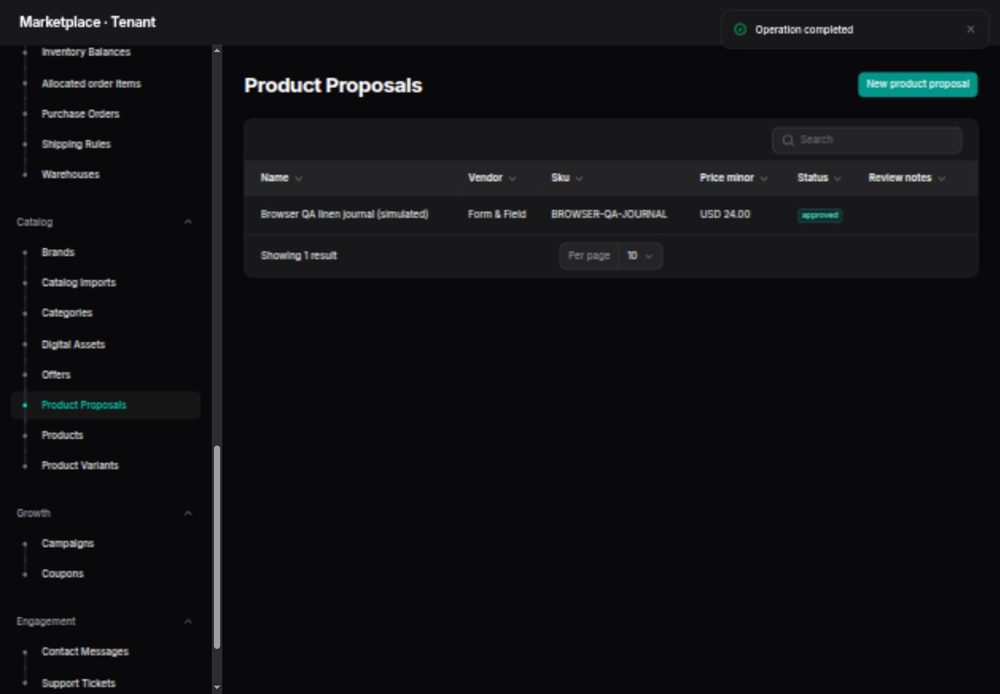
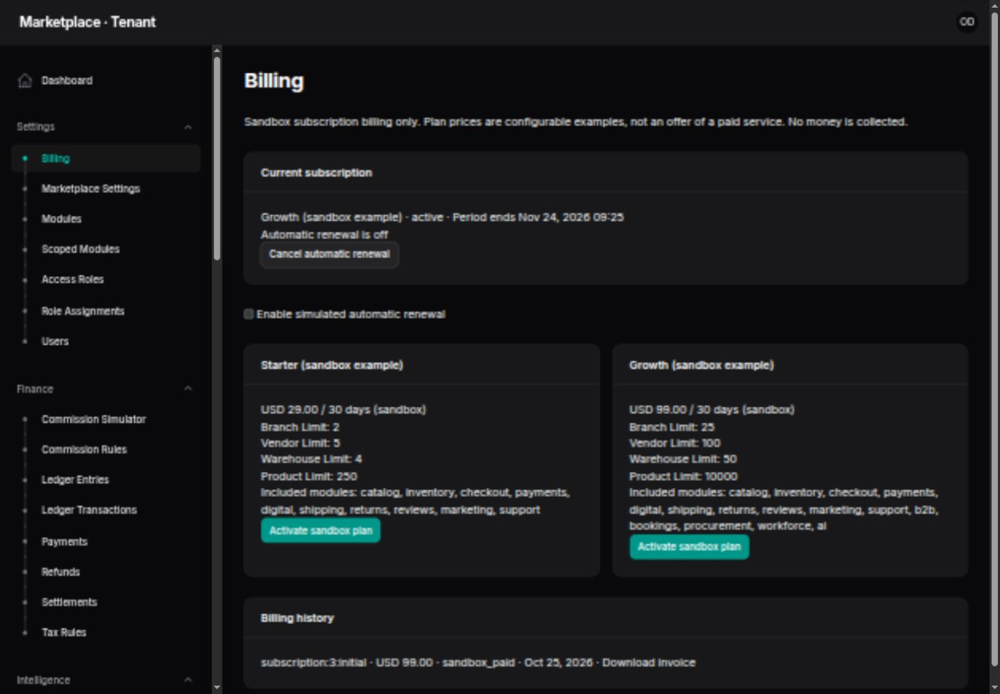
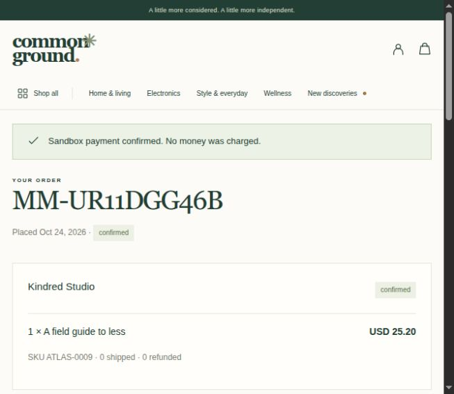
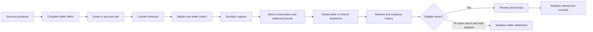

<div align="center">

# Multi-vendor Marketplace

### Independent sellers. One connected business.

**A Laravel marketplace for bringing products, sellers, stock, orders and financial records into one operating system.**

Demonstration storefront: **Common Ground** · Built by **[Imran Ahmed](https://imrandev.bd)**


[Explore the interface](#see-the-application) · [Business value](#what-your-business-gains) · [Features](#feature-catalog) · [Run locally](#run-it-locally) · [Documentation](#documentation)

</div>


A marketplace becomes difficult to run when every seller, warehouse and order lives in a different spreadsheet. This application connects the customer experience to the operational work behind it: seller offers, warehouse availability, split orders, pricing policies, fulfillment, returns and accounting events.

Customers discover products through a considered storefront. Sellers manage their own business records. Branch teams work on allocated stock and order lines. Marketplace owners control access, modules and plans from dedicated dashboards.

> **Current release:** a working, tested sandbox marketplace with real persisted workflows. Live payment, payout and carrier adapters remain unfinished, and the full enterprise roadmap is not complete. See the [acceptance matrix](docs/FEATURE_MATRIX.md), [verification record](docs/VERIFICATION.md) and [known limitations](docs/KNOWN_LIMITATIONS.md). Screenshots show the actual local application with fictional demonstration data.

## At a glance

| For the business | For the team building it |
|---|---|
| Four operational panels for platform, marketplace, seller and branch teams | Laravel 12, Filament 4, Livewire 3 and Sanctum 4 |
| Shared master catalog with independent seller offers | Explicit tenant context and scoped record access |
| One checkout with separate seller fulfillment | Locked stock allocation and idempotent financial operations |
| Configurable commissions, tax, shipping and plan entitlements | Integer money and immutable historical snapshots |
| Product review, CSV staging, stock movements and return decisions | 117 tests / 398 assertions on both SQLite and PostgreSQL |
| Sandbox subscription billing and customer commerce API | PostgreSQL transaction tests, source documentation and deployment configuration |

## See the application

### A shopping experience with its own identity

The storefront combines editorial collections, category discovery, search, filters, seller pages, saved finds and account access. Product pages present available seller offers alongside their prices and stock.

[](docs/screenshots/product-detail.jpg)

### Operations connected to the storefront

<table>
  <tr>
    <td width="50%" valign="top">
      <h4>Marketplace operations</h4>
      <a href="docs/screenshots/operations-dashboard.jpg"></a>
      <p>Orders, stock and operational resources within the operator’s authorized scope.</p>
    </td>
    <td width="50%" valign="top">
      <h4>Reviewed seller publishing</h4>
      <a href="docs/screenshots/catalog-approval.jpg"></a>
      <p>Draft → review → approval → published product, offer and initial stock.</p>
    </td>
  </tr>
  <tr>
    <td width="50%" valign="top">
      <h4>Plans, quotas and billing history</h4>
      <a href="docs/screenshots/billing.jpg"></a>
      <p>Configurable sandbox subscriptions, period snapshots and invoices.</p>
    </td>
    <td width="50%" valign="top">
      <h4>Customer order confirmation</h4>
      <a href="docs/screenshots/sandbox-order.jpg"></a>
      <p>Persisted order details after sandbox capture; no real charge.</p>
    </td>
  </tr>
</table>

<details>
<summary>More interface captures: compact layouts and dark theme</summary>

| Storefront | Dark theme |
|---|---|
|  |  |

All artwork is stored locally. The product illustrations were created for this application; demo seller activity, reviews and sales figures are simulated. Images are interface evidence, not real customer endorsements.

</details>

## What your business gains

### A shared view of daily work

| Operational problem | Implemented workflow | Business opportunity |
|---|---|---|
| Seller prices and products scattered across files | Shared master products with seller-specific offers | Expand assortment while retaining seller ownership |
| Repeated manual order allocation | Checkout creates master/vendor orders and warehouse allocations | Reduce copying between customer service and fulfillment teams |
| Stock sold twice during competing orders | Locked reservations, capture and release | Reduce avoidable stock-allocation errors |
| Commissions recalculated by hand | Effective-dated commission rules and checkout snapshots | Apply consistent seller terms and explain historical amounts |
| New products published without review | Rights confirmation, proposals, approval and CSV staging | Give sellers an onboarding path while retaining catalog control |
| Branch staff see unrelated work | Scoped stock, allocated order items and role permissions | Delegate operations with narrower access |
| Refund calculations differ from the original sale | Quantity-based reversal from original snapshots | Preserve a traceable connection between sale, return and refund |
| Teams cannot explain a stock change | Immutable movements with references | Investigate inventory differences using recorded events |
| Plan limits depend on manual checking | Branch/vendor/warehouse/product quotas and module entitlements | Model service tiers with consistent restrictions |
| Customers repeatedly ask for order details | Account history, shipment status and invoice download | Offer self-service access to information already recorded |

### Where it can save time

The implemented services automate repetitive calculations and record creation: seller order splitting, warehouse allocation, coupon checks, commission/tax/shipping calculations, reservation release, invoice rendering and balanced journal creation. CSV staging can reduce repeated entry when onboarding new products. Human review, fulfillment and exception handling still require staff.

**Illustrative planning example — these are assumptions, not measured customer results:**

| Input | Example assumption |
|---|---:|
| Orders processed each working day | 100 |
| Manual allocation/calculation/recording time per order | 3 minutes |
| Remaining review time with connected workflows | 45 seconds |
| Working days each month | 22 |
| Potential administrative time released | **3.75 hours/day · 82.5 hours/month** |

```text
Hours released per month =
  orders per day × (manual minutes − remaining minutes) × working days ÷ 60

100 × (3 − 0.75) × 22 ÷ 60 = 82.5 hours/month
```

At an assumed internal labor cost of **$10/hour**, that is **$825/month of staff capacity** in this example, before hosting, setup, training, integrations and maintenance. It is not guaranteed cash savings or a performance benchmark. Replace every input with observed timings from your own team; avoid counting the same saved work twice.

Other potential benefits—fewer allocation mistakes, faster product onboarding and clearer seller statements—depend on business process quality and should be measured in a pilot.

## Business models and expansion opportunities

| Opportunity | Foundation available today | What a live business still needs |
|---|---|---|
| A curated marketplace for independent brands | Discovery, seller offers, commission rules, split fulfillment | Certified payment/payout adapters and operating policies |
| A retailer expanding through partner sellers | Shared catalog, reviewed publishing, stock allocation | Seller onboarding/KYC, provider integration and service agreements |
| A multi-branch retail operation | Branch/warehouse hierarchy, scoped staff, allocated fulfillment | Advanced warehouse procedures, carrier integration and operational training |
| A platform offering marketplaces to separate organizations | Tenant isolation, platform controls, plans, quotas, sandbox invoices | Live SaaS billing, verified domains, onboarding and lifecycle operations |
| Digital resource sales | Private versioned files, owned signed downloads, limits/expiry | Real payment integration and distribution policies; licenses/memberships are future work |
| Wholesale lead generation | Quantity quotation request, seller offer and buyer acceptance | Quote-to-order, negotiated terms, credit and procurement workflows |
| Simple appointment-based listings | Unique hourly service slots and booking completion | Staff calendars, deposits, rescheduling and reminders |
| A custom commerce product for a particular industry | Modular Laravel source, customer API and documented services | Industry-specific implementation and validation |

**Potential revenue paths:** seller commissions, marketplace subscription tiers, digital product sales and wholesale/service transactions. The commission and entitlement mechanics are implemented; actual collection and payout remain sandbox-only. Sponsored placement, affiliate revenue, loyalty programs and advanced CRM are roadmap opportunities rather than current capabilities. No revenue or conversion result is promised.

## Feature catalog

“Implemented” describes the actual bounded workflows below, not every capability in the original enterprise brief. Payment-related features operate in the internal sandbox.

### Customer storefront and account

- Responsive Common Ground storefront with original local illustrations, editorial sections and category discovery.
- Search by product text; filter by category, brand, seller and price; sort by newest or price.
- Product details, specifications, gallery and approved seller offers with current stock.
- Seller storefront pages and verified completed-purchase product reviews.
- Guest carts, persistent account carts and one-time guest-to-account cart merging; quantities combine up to 100 per offer.
- Quantity changes, item removal, percentage coupons and multi-vendor checkout.
- Registration, login, logout and tenant-bound password recovery with single-use reset links.
- Customer order history, shipment tracking, cancellation of unpaid orders and PDF invoice downloads.
- Saved finds, saved addresses, support tickets with staff reply, in-app notifications and seller applications.
- Physical return requests for eligible delivered quantities within the 14-day policy.
- Partial English/Bengali navigation/hero/newsletter labels and browser-preference dark mode.
- Editable informational pages, contact/newsletter persistence, canonical metadata, sitemap and robots output.
- Historical product, seller and content URLs redirect directly to their current public URL.

### Platform, tenancy, access and modules

- Separate `/admin`, `/tenant`, `/vendor` and `/branch` Filament panels.
- Tenant creation, active/suspended availability, domain field and audited platform tenant switching.
- Required tenant context for scoped models, tenant-owned reference checks and seller/branch record constraints.
- Protected baseline roles plus configurable tenant/vendor/branch role grants and denials.
- Entity view/create/update/execute permissions, named workflow permissions and audited assignment revocation.
- Dashboard aggregates respect the same entity permissions and scopes as operational records.
- Module registry contract, dependency/cycle validation and protected core catalog.
- Effective module availability combines platform, tenant, subscription, vendor, branch and role constraints.
- Dependency and active-obligation checks before deactivation; history is preserved.
- Marketplace name, currency, locale, timezone, default rates and branch entitlements.
- Currency changes are restricted once financial history exists.

### Catalog and seller onboarding

- Master products, hierarchical categories, brands and seller-specific offers/SKUs/prices.
- Master variants with attributes, barcode and weight; selected variant snapshots at checkout.
- Product specifications, public galleries and a neutral fallback for missing imagery.
- Seller applications, approval and administrator account assignment.
- Seller product proposals with description, category, SKU, price, warehouse, initial quantity and rights confirmation.
- Optional private proposal images, human review, approval/rejection and idempotent publication.
- Approval creates the product, offer and initial immutable stock receipt.
- Private CSV upload, row validation, duplicate-SKU checks and once-only staging into review proposals.
- CSV limits: 2 MB / 1,000 rows; it does not silently publish or overwrite existing stock/prices.
- Historical slug reservation prevents an unrelated record from claiming an old URL.

### Branches, inventory and fulfillment

- Vendor → branch → warehouse structure with plan quota enforcement.
- Warehouse balances, available/reserved stock, reorder points and low-stock visibility.
- Locked allocation across eligible warehouses and immutable reservation/stock movements.
- Controlled stock adjustment and atomic direct transfer within the same seller/offer.
- Inventory references reject reuse with a different movement payload.
- Branch-scoped stock and allocated order-line views.
- Item-level partial shipments, remaining-quantity validation and manual carrier/tracking entry.
- Branch operators ship only their own allocated units.
- Immutable shipment quantities/events, delivery recording and packing-slip PDFs.
- Optional shipment idempotency keys in the domain service.
- Single-line purchase receipt into warehouse stock and basic staff/manual attendance records.

### Checkout, pricing and financial records

- Atomic multi-vendor checkout with master orders, seller suborders and warehouse-allocated lines.
- Price, product, SKU, variant, tax, commission and shipping snapshots.
- Coupon expiration/usage-limit checks serialized with checkout.
- Effective-dated commissions by seller, product, category, tenant plan and subtotal tier.
- Percentage, fixed-per-unit and hybrid commission calculations with min/max caps.
- Commission simulator using the same calculation service without moving money.
- Country/category/product exclusive merchandise tax rules.
- Seller/branch/country shipping rules: flat, per item, weight and free-shipping threshold.
- Integer minor-unit money and basis-point percentages.
- Sandbox provider contract, capture and signed HMAC callback endpoint.
- Exact payment amount/currency checks and duplicate capture protection.
- Unpaid order cancellation/expiry with reservation release.
- Balanced double-entry journals for capture, refund, settlement and sandbox subscription invoices.
- Vendor liabilities, commission/tax/shipping records and sandbox settlement after the delivery hold.
- SQLite/PostgreSQL triggers protect core financial/event histories from update/delete.

### Returns and digital delivery

- Return request → authorization → receipt or rejection → sandbox refund.
- Quantity validation against delivered, already returned and open-request quantities.
- Cumulative refund allocation from the original sale; the final unit consumes rounding remainders.
- Commission/tax/vendor-liability reversal and controlled stock restoration.
- Return rights remain available after a later module or subscription change.
- Original shipping is retained; settled orders require a future recovery workflow.
- Private digital asset uploads with rights confirmation and purchase-time version snapshots.
- Digital purchases require an account; capture grants owned download entitlements.
- Signed links expire after 10 minutes; entitlements default to 30 days / three downloads.
- Locked download counters, ownership checks and revocation after a full refund.

### SaaS billing and supporting modules

- Editable global sandbox subscription plans with prices, periods, quotas and included modules.
- Owner activation, optional simulated automatic renewal and cancellation at period end.
- Immutable invoices, PDF download and separate subscription journal entries.
- Snapshotted prices/periods/entitlements; same-plan activation does not create a duplicate invoice.
- Branch/vendor/warehouse/product quotas and downgrade checks against existing usage/obligations.
- Daily idempotent renewal processing; subscription expiry preserves historical records.
- Basic B2B quotation request, seller quote and buyer acceptance.
- Serialized unique future hourly service slots and completion.
- Coupons, draft campaigns, local newsletter/contact collection and support replies.
- Reviewed deterministic AI suggestion drafts, isolated AI Hub fake-adapter test and sanitized administrator diagnostics.
- Explicit-tenant queued in-app order confirmation jobs and a mark-read action.

### Customer API

| Endpoint group | Capability |
|---|---|
| Public catalog | Paginated published products and eligible seller offers |
| Authentication | Tenant-bound 30-day token issuance and current-token revocation |
| Cart | Read active account bag; add/update/remove items |
| Checkout | UUID-keyed idempotent checkout and stock reservation |
| Orders | Own summaries/details, item shipment tracking, sandbox payment and unpaid cancellation |
| Returns | Owned delivered-item return requests |
| Sandbox webhook | Raw-body HMAC verification and idempotent capture |

Mutations require explicit Sanctum abilities as well as ownership. Tokens issued by this API never confer administrative permissions. Password reset revokes existing API tokens. See the [API guide](docs/API.md) and [OpenAPI definition](docs/openapi.yaml).

## One order, connected from discovery to return



Digital lines follow a separate capture → owned entitlement → signed download path. Service appointments use the booking workflow rather than physical checkout.

## Who uses each workspace?

| Workspace | Typical users | Primary work |
|---|---|---|
| Platform `/admin` | Super administrator | Tenants, platform controls, subscription plans and diagnostics |
| Marketplace `/tenant` | Owner, administrator, authorized finance/support/staff | Catalog review, pricing, modules, access, orders and financial records |
| Seller `/vendor` | Vendor owner or manager | Owned offers, imports/proposals, stock, quotations and fulfillment |
| Branch `/branch` | Branch or warehouse operator | Scoped locations, stock, purchase receipts and allocated shipment lines |
| Customer `/account` | Shopper or corporate buyer | Own orders, saved finds, addresses, support, quotes and appointments |

Access depends on both role permissions and record scope. A panel entry point does not grant unrestricted access to every resource.

## Explore the local demo

The fresh seed includes:

| Dataset | Count |
|---|---:|
| Marketplaces / sellers | 2 / 5 |
| Branches / warehouses | 12 / 8 |
| Categories / brands | 20 / 30 |
| Products / seller offers | 204 / 304 |
| Customer identities / orders | 100 / 250 |
| Return requests / refunds | 50 / 30 |
| Sample reviews / coupons / draft campaigns | 100 / 25 / 10 |
| Tenant subscription records | 5: two active and three historical |

Both marketplaces also include a private digital handbook and a service listing. Browser verification may add extra records. Some delivery timestamps are backdated to demonstrate the settlement hold; this dataset is a workflow demonstration, not a real sales history.

**Local demo password: `Demo@12345`**

| Role | Email | Entry point |
|---|---|---|
| Super administrator | `superadmin@demo.test` | `/admin` |
| Marketplace owner / administrator | `owner@demo.test` / `admin@demo.test` | `/tenant` |
| Seller owners | `vendor1@demo.test` / `vendor2@demo.test` | `/vendor` |
| Seller manager | `manager@demo.test` | `/vendor` |
| Branch / warehouse operator | `branch@demo.test` / `warehouse@demo.test` | `/branch` |
| Accountant / support | `finance@demo.test` / `support@demo.test` | `/tenant` |
| Shoppers | `customer1@demo.test` / `customer2@demo.test` | `/login` |
| Corporate buyer | `business@demo.test` | `/login` |
| Second marketplace owner | `owner2@demo.test` | `/tenant` |

Demo access is restricted to local/testing mode. Production boot refuses demo mode. Do not expose this privileged shared demonstration installation publicly.

**Suggested walkthrough:** explore the storefront → compare offers → place a sandbox order → confirm payment → inspect seller/branch allocation → record partial shipment and delivery → request/receive/refund an eligible return → inspect the journal. Separately, try a product proposal, commission simulation, scoped role and sandbox plan upgrade.

## Run it locally

### Requirements

| Dependency | Supported/tested setup |
|---|---|
| PHP | **8.5**, matching the resolved locked dependency set |
| Composer | 2 |
| Node.js | 22.19+; verified locally on Node 22 |
| Database | SQLite for a quick start; PostgreSQL for deployment-oriented transaction checks |
| Redis | Optional locally; supported configuration for queue/cache/session services |
| PHP extensions | bcmath, ctype, curl, dom, fileinfo, filter, hash, intl, mbstring, openssl, PDO, session, tokenizer, xml, xmlwriter, zip, plus the database PDO driver |

Redis configuration requires its PHP extension; pcntl is needed for the corresponding production worker environment. MySQL has not been release-verified. The original brief requested PHP 8.3 as a minimum; this repository deliberately declares the tested PHP 8.5 dependency set.

### Install dependencies and assets

Run these commands from the project directory. On an existing installation, preserve `.env` and its `APP_KEY` rather than replacing them.

```bash
composer install
cp .env.example .env
php artisan key:generate

touch database/database.sqlite
php artisan migrate
php artisan storage:link

npm ci
npm run build
```

Choose **one** initialization mode on an empty database:

```bash
# Option A: a fictional local demo.
# Set MARKETPLACE_DEMO=true and PAYMENT_SANDBOX=true in .env first.
php artisan marketplace:demo-seed
```

```bash
# Option B: a fresh installation with your own administrator.
# Keep MARKETPLACE_DEMO=false. The command asks for a password securely.
php artisan marketplace:install --email=you@example.com
```

Start the application, worker and scheduler in separate terminals:

```bash
php artisan serve --host=127.0.0.1 --port=8000
```

```bash
php artisan queue:work --tries=3
```

```bash
php artisan schedule:work
```

Open [the local storefront](http://127.0.0.1:8000), `/shop`, `/platform` or `/demo`. This is a localhost address, not a hosted public demo. The installer/seeder does not reset existing business records. An older local demo can add missing subscription examples after migration with `php artisan marketplace:demo-additions`.

### Configuration and operational behavior

| Area | Configuration / behavior |
|---|---|
| Tenancy | `MARKETPLACE_TENANT` supplies the default storefront slug; authenticated users resolve to their account tenant |
| Database | SQLite by default; set the standard `DB_*` variables for PostgreSQL |
| Queue/cache/session | Local database drivers; Redis can be configured with `QUEUE_CONNECTION`, `CACHE_STORE`, `SESSION_DRIVER` and `REDIS_*` |
| Mail | Configure Laravel mail transport for reset delivery; log transport is for local development. Commerce confirmations currently create in-app notifications |
| Public media | `storage:link` exposes only approved public catalog assets/galleries |
| Private media | Proposal images, CSV imports and digital files remain in private tenant storage |
| Payments | `PAYMENT_SANDBOX=true`; set `PAYMENT_WEBHOOK_SECRET` for the internal signed callback protocol |
| AI | Local drafts/fake tests only; no live inference credentials required |
| Scheduler | Every-minute unpaid-order expiry; daily sandbox subscription renewal |
| Money | Integer minor units; basis points for percentages; one financial currency per marketplace |
| Modules | `marketplace:sync-modules` adds new registry entries disabled and preserves existing states |
| Integrity | `marketplace:verify --json` reconciles journal balance, stock movements and order arithmetic |

## Architecture and technology

The application is a modular monolith: one deployable Laravel application with transactional services for business workflows. It provides a single place to change a policy while preserving tenant boundaries and historical results.

```text
app/Domain/                Checkout, inventory, pricing, billing, access and module services
app/Models/                Tenant-scoped persistence, relationships and immutable events
app/Filament/              Four panels, operational resources, workflow actions and pages
app/Http/Controllers/      Storefront, account, downloads, authentication and customer API
app/Jobs/                  Explicit-tenant queued notifications
config/marketplace.php     Module registry and dependency metadata
config/resources.php       Operational resource forms/columns
resources/views/           Storefront, account, marketing, invoices and administration views
database/migrations/       Additive schema and database event protections
database/seeders/          Explicit fictional demo and configurable example plans
tests/                     Feature/unit coverage and independent-process race harness
docs/                      Business scope, architecture, operations, API and screenshots
```

### Owner packages: what is actually integrated

| Package | Actual use/status |
|---|---|
| `imrandevbd/laravel-unicode-pdf` | Native customer/subscription invoices and packing slips; generated PDF bytes tested |
| `imrandevbd/laravel-universal-slug` | Product/store slug creation; Bengali slug test and application URL history |
| `imrandevbd/laravel-ai-hub` | Isolated fake-adapter test; global settings/studio disabled |
| `imrandevbd/drutogoti` | Capture container reused for sanitized in-memory administrator diagnostics; raw watchers disabled |
| `imrandevbd/laravel-ai-catalog` | Locked dependency; auto-discovery disabled pending a tenant-safe integration |
| `imrandevbd/laravel-attendance-hub` | Locked dependency; device/route integration disabled pending a tenant-safe adapter |

The separate `laravel-admin-panel` package was reviewed and excluded because its default `/admin` routes compete with Filament. Installed dependencies are not presented as completed provider integrations. [Exact package versions and decisions →](docs/INTEGRATIONS.md)

## Verification and engineering safeguards

The latest suites pass **117 tests / 398 assertions on SQLite and PostgreSQL**. Detailed environment and independent concurrent-process results are recorded in [VERIFICATION.md](docs/VERIFICATION.md); test counts and environments are stated separately so a static badge is not mistaken for hosted CI.

Coverage includes tenant leakage/reference checks, role denials, branch actions, module inheritance, stock races, checkout rollback, pricing snapshots, coupons, capture retries, refunds, settlement holds, digital ownership, catalog staging/review, subscription quotas/renewal, customer API scopes, password recovery and historical URLs.

The eight-worker PostgreSQL race checks showed:

- One successful checkout for the last unit; seven competing attempts blocked.
- One capture journal for repeated capture requests.
- One eligible refund for competing returns against the same quantity.
- One settlement for repeated settlement requests.
- One redemption of the final coupon use.
- Transfers bounded by available stock, with balanced journals and valid inventory invariants.

These are specific correctness checks, not a throughput benchmark or independent security certification.

```bash
php artisan test
vendor/bin/pint --test
composer validate --strict
composer audit --locked
npm audit
npm run build
php artisan marketplace:verify --json
```

The standalone race harness requires an **isolated PostgreSQL database whose name ends in `_concurrency`**. It creates test fixtures and refuses other database names:

```bash
DB_CONNECTION=pgsql DB_HOST=127.0.0.1 DB_DATABASE=marketplace_concurrency \
  DB_USERNAME=marketplace DB_PASSWORD=... php artisan migrate --force

DB_CONNECTION=pgsql DB_HOST=127.0.0.1 DB_DATABASE=marketplace_concurrency \
  DB_USERNAME=marketplace DB_PASSWORD=... php tests/Concurrency/run.php
```

GitHub Actions configuration is supplied. A hosted CI run, Docker image build, production deployment, load benchmark and backup restore drill are not claimed without actual execution.

## Roadmap and commercial readiness

The repository provides a substantial starting point for a marketplace business and its engineering team. Commercial operation still requires integration, policy and infrastructure work appropriate to that business.

| Area | Remaining work |
|---|---|
| Real financial providers | Hosted payment checkout, payout, refunds, disputes/chargebacks and external reconciliation |
| Carrier operations | Live rates, labels, tracking callbacks, proof of delivery and reverse logistics |
| SaaS lifecycle | Real recurring billing, proration/dunning, verified domains, metering, export/archive workflows |
| Advanced warehouse management | Bins, lots/serials/expiry, counts, picking/putaway and transfer approvals |
| Advanced product information | Full translations/version comparison, supplier feeds, richer media review and exports |
| B2B | Quote-to-order, negotiation, credit, contracts and organizational procurement |
| Digital and services | License pools, memberships, S3 delivery, staff calendars, deposits and rescheduling |
| Growth | CRM, affiliates, loyalty, gift cards, segmentation and actual campaign delivery |
| Workforce | Device ingestion, shifts/leave, payroll and retention controls |
| AI | Live providers, encrypted credentials, budgets and evaluated generation/import workflows |
| Localization | Whole-application translation, RTL and locale-specific URLs |
| Release assurance | Independent security/accessibility review, restore drill, load tests and target-host deployment validation |

See the [full acceptance matrix](docs/FEATURE_MATRIX.md) and [original brief](docs/PROJECT_BRIEF.md). Informational industry pages explain possible extensions; they do not mean every specialized workflow is implemented. Complex-script/RTL PDF visual coverage is not certified. MySQL event protections and container runtime remain unverified.

## Deployment and maintenance

Deployment source includes a PHP 8.5 FPM image, Nginx, PostgreSQL 18, Redis 8, queue worker, scheduler and GitHub Actions workflow. Compose binds the web service to localhost for a TLS reverse proxy; database and Redis are not publicly published. Uploaded storage is persistent, with a read-only public-media mount for Nginx.

For a target environment, configure HTTPS, trusted hosts/proxies, a stable `APP_KEY`, secure sessions, database credentials, private storage, queues, scheduler and mail. Keep demo mode and debug disabled. Use the installer rather than known demo credentials. Implement/certify live payment and carrier adapters before handling real commerce.

For upgrades: back up the database and storage, review dependency changes, run verification, deploy assets/code, apply additive migrations, synchronize new modules disabled, and restart workers. Never regenerate an established `APP_KEY` or modify historical financial events to force a balance. Restore checks should verify private files and stock/ledger reconciliation as well as database rows.

[Deployment guide](docs/DEPLOYMENT.md) · [Operations and backups](docs/OPERATIONS.md) · [Security](docs/SECURITY.md)

## Documentation

| Topic | Guide |
|---|---|
| Scope and current evidence | [Feature matrix](docs/FEATURE_MATRIX.md), [Known limitations](docs/KNOWN_LIMITATIONS.md), [Verification](docs/VERIFICATION.md) |
| Architecture and persistence | [Architecture](docs/ARCHITECTURE.md), [Database](docs/DATABASE.md), [Schema](docs/schema.json) |
| Tenants and staff | [Multi-tenancy](docs/MULTI_TENANCY.md), [Branches](docs/MULTI_BRANCH.md), [Access control](docs/ACCESS_CONTROL.md) |
| Modules | [Development guide](docs/MODULES.md), [Dependency matrix](docs/MODULE_DEPENDENCIES.md) |
| Catalog and pricing | [Catalog publishing/import](docs/CATALOG.md), [CSV example](docs/examples/catalog-import.csv), [Pricing rules](docs/PRICING.md) |
| Financial workflows | [Payments](docs/PAYMENTS.md), [Ledger](docs/FINANCIAL_LEDGER.md), [SaaS billing](docs/BILLING.md) |
| Integrations and API | [Package decisions](docs/INTEGRATIONS.md), [Customer API](docs/API.md), [OpenAPI](docs/openapi.yaml) |
| Running and extending | [Demo](docs/DEMO.md), [Testing](docs/TESTING.md), [Localization](docs/LOCALIZATION.md), [Implementation plan](docs/IMPLEMENTATION_PLAN.md) |
| Release and history | [Deployment](docs/DEPLOYMENT.md), [Operations](docs/OPERATIONS.md), [Security](docs/SECURITY.md), [Changelog](CHANGELOG.md) |

### Troubleshooting

| Symptom | Check |
|---|---|
| Marketplace returns 503 | Run installation; check active tenant, domain/default slug and suspension state |
| Module action is unavailable | Check dependencies, platform/tenant/scoped controls, plan and role denial |
| Product images are missing | Run `storage:link`; verify the public disk and asset/storage persistence |
| Frontend or panel assets are missing | Run `npm run build` and `php artisan filament:assets` |
| A settlement is blocked | Check delivery age, unresolved returns and already settled state |
| Reset email does not arrive | Check configured mail transport; the local log driver does not deliver externally |
| Notifications remain queued | Run the worker and inspect `php artisan queue:failed` |
| A custom job reports missing tenant context | Carry the tenant ID and restore/clear context in a `finally` block |

## Contributing, authorship and license

Contributions should complete a business workflow with authorization, validation, transactions, interface, meaningful tests and truthful documentation. Keep financial/stock history immutable, preserve tenant boundaries, and extend domain services rather than changing business state through generic status editors.

**Developer:** [Imran Ahmed](https://imrandev.bd) · [me@imrandev.bd](mailto:me@imrandev.bd)

New commits must use **Imran Ahmed <me@imrandev.bd>** as both author and committer. Preserve existing third-party authorship and licenses. New application code is [MIT-licensed](LICENSE); dependencies retain their respective licenses.

<div align="center">

**Explore the workflows. Adapt the platform. Build the business around it.**

[Developer website](https://imrandev.bd) · [Start locally](#run-it-locally) · [Browse the documentation](#documentation)

</div>

## 🤝 Let's Connect & Collaborate

I am open to **Senior Remote Full-Stack Roles**, **AI Platform Architecture Contracts**, and **Enterprise Technical Advisory**.

**Timezone:** UTC+6 (Dhaka / Rangpur, Bangladesh) — Flexible overlap with US, UK, and European business hours.

**Delivery Mode:** Async-ready, Slack, Discord, Jira, GitHub, and production-first accountability.

| Channel | Address / Handle | Quick Action |
|---|---|---|
| 🌐 Primary Portfolio | `imrandev.bd` | [Visit Site ↗](https://imrandev.bd) |
| 📦 Packagist Packages | `packagist.org/packages/imrandevbd/` | [View Packages ↗](https://packagist.org/packages/imrandevbd/) |
| 💼 LinkedIn Profile | `linkedin.com/in/imranbru99` | [Connect ↗](https://www.linkedin.com/in/imranbru99) |
| 🐙 GitHub Profile | `github.com/imranbru99` | [Follow ↗](https://github.com/imranbru99) |
| 💬 WhatsApp Direct | +880 1576-918420 | [Chat Now ↗](https://wa.me/8801576918420) |
| 📧 Direct Email | `me@imrandev.bd` | [Send Email ↗](mailto:me@imrandev.bd) |
| 🐦 X (Twitter) | `@imrandev_bd` | [Follow ↗](https://x.com/imrandev_bd) |
| 📺 YouTube Tech | `@ImranDevBD` | [Subscribe ↗](https://www.youtube.com/@ImranDevBD) |
